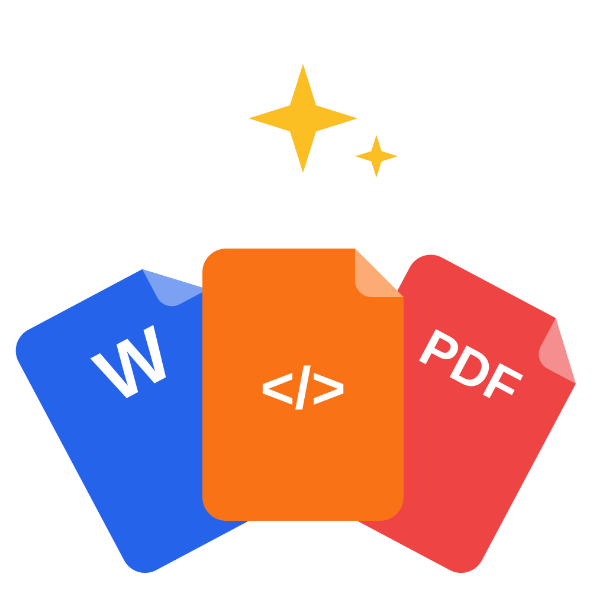
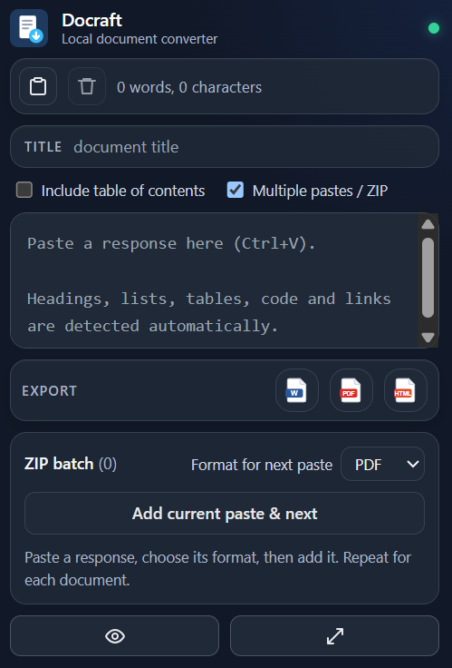
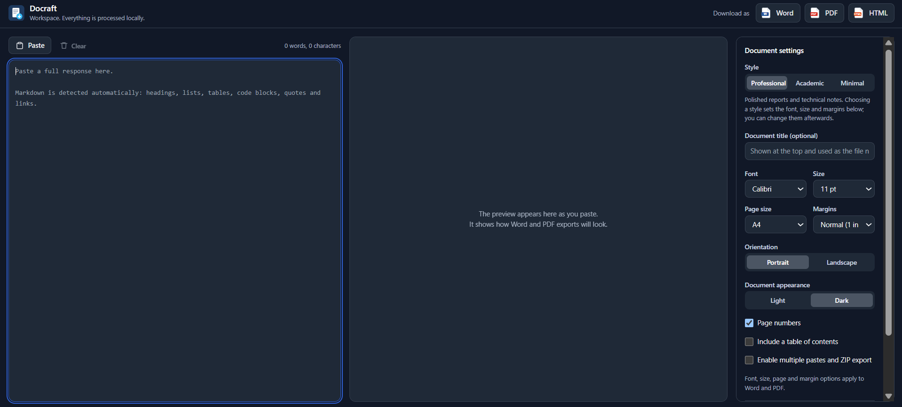

<div align="center">
  
  <h1>Docraft</h1>
  <p><strong>Turn pasted AI responses into polished documents.</strong></p>
  <p>
    
    <a href="./LICENSE"></a>
    
  </p>
  <p>
    <a href="#features">Features</a> ·
    <a href="#getting-started">Getting started</a> ·
    <a href="#privacy">Privacy</a>
  </p>
</div>

Docraft is a local-first Chrome extension that converts pasted AI responses into editable **Word (.docx)**, styled **PDF**, or standalone **HTML** files. It is designed for fast paste-and-export workflows while still offering a full workspace for detailed formatting.

No server, account, AI API, analytics, or content scripts are required.

## Preview

### Compact popup

The popup is optimized for quick workflows: enter an optional document title, paste your response, then use the icon buttons to export or open the full workspace.

<div align="center">
  
</div>

### Full workspace

The workspace provides a larger editor, live document preview, export controls, and document settings including font, page layout, appearance, title, and page numbers.

<div align="center">
  
</div>

## Features

- **Fast compact popup** — paste and export from a small, icon-focused interface.
- **Popup title field** — set the document title before exporting without opening the workspace.
- **Full workspace** — edit content, inspect a live preview, and configure document settings.
- **Multiple formats** — export to Word, PDF, or HTML.
- **Optional table of contents** — include a linked contents section in HTML or a formatted contents section in Word and PDF.
- **Multiple-paste ZIP batches** — add responses one at a time, choose a format for each, and download the batch as a ZIP.
- **PDF math rendering** — KaTeX renders supported LaTeX formulas as crisp images in PDF exports.
- **Markdown-aware parsing** — detects headings, paragraphs, lists, tables, code blocks, quotes, links, and inline formatting.
- **Readable numbered lists** — automatically bolds lead terms such as `1. Project overview: ...`.
- **Light and dark documents** — choose a white document or a near-black document with white text for Word and PDF output.
- **Document controls** — configure font, size, page size, orientation, margins, title, and page numbers.
- **Font support** — supports Calibri, Arial, Times New Roman, Georgia, and Cambria settings.
- **Calibri-compatible PDFs** — embeds the open-source Carlito typeface for metrically compatible Calibri-style PDF output.
- **Privacy by design** — content is processed locally in the browser.

## Getting started

### Install from source

```bash
npm install
npm run build
```

### Load in Chrome

1. Open `chrome://extensions`.
2. Enable **Developer mode**.
3. Choose **Load unpacked** and select the generated `dist/` folder.
4. Pin **Docraft**, click its icon, and paste your content.
5. Select an export icon, or open the workspace for advanced settings.

After rebuilding, click **Reload** on the Docraft entry in `chrome://extensions` before testing the updated build.

## Development

```bash
npm run dev       # watch-build the extension
npm run typecheck # run TypeScript checks
npm test          # run parser, exporter, and UI tests
npm run build     # type-check and create dist/
npm run samples   # create sample Word, PDF, and HTML files
```

## Project structure

```text
public/            Extension manifest, icons, branding, and bundled fonts
popup.html         Compact popup entry point
workspace.html     Full workspace entry point
src/core/          Parser, document types, settings, filenames, and safety helpers
src/exporters/     Word, PDF, HTML, font loading, and download logic
src/ui/            Editor, toolbar, preview, settings, status, and export controls
src/popup/         Popup React entry point
src/workspace/     Workspace React entry point
src/platform/      Chrome storage, clipboard, and tab integrations
tests/             Parser, exporter, and UI tests
```

## Privacy

- Only the `storage` permission is required.
- `clipboardRead` is optional and requested only when the Paste action needs it.
- No host permissions are used.
- Pasted content is not saved by default.
- The optional **Remember my draft** setting stores text unencrypted in `chrome.storage.local`.
- Popup-to-workspace handoff uses temporary session storage and is deleted after it is read.
- In-progress ZIP batches use temporary session storage so they survive closing the popup, and are cleared after export or when the browser session ends.
- Pasted HTML is treated as literal text; it is never rendered with `innerHTML`.
- Only validated `http`, `https`, `mailto`, and `tel` links become active.

## Known limitations

- PDF fonts support Latin, Greek, Cyrillic, and many symbols. CJK and complex scripts such as Arabic shaping and Indic scripts may not render fully; Docraft warns after export when characters are unsupported.
- Word may substitute fonts if the selected font is not installed on the system.
- Calibri PDF output uses bundled Carlito because Microsoft Calibri cannot be redistributed by the extension.
- Preview page breaks are estimates.
- Landscape mode is manual; wide tables are scaled using smaller type and tighter padding.
- Dark appearance is intended for on-screen reading and dark PDFs.

## License

Docraft is licensed under the [MIT License](./LICENSE).

Docraft's bundled font assets retain their respective licenses. See the license files in [`public/fonts/`](./public/fonts/).
